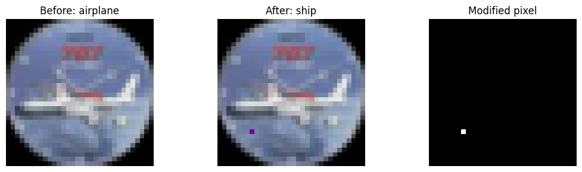

# One Pixel Attack Lab

**One pixel. Five search parameters. No gradients.**

A PyTorch implementation of score-based, black-box adversarial search, refactored
from the original project notebook. Differential evolution is implemented manually
with NumPy; PyTorch handles model training and inference. No SciPy optimizer or
third-party attack implementation is used.



*Saved visualization from the supplied notebook, retained as historical evidence;
it is not a newly generated benchmark result.*

## What is included

- Untargeted and targeted one-pixel attacks, preserving the notebook's search logic.
- Handwritten differential mutation, clipping, and parent-child selection.
- CIFAR-10 ResNet-18 / VGG-16 checkpoint adapters from the notebook.
- A small CNN training workflow with a held-out validation split.
- A matched-budget random-search baseline, per-image records, query accounting,
  confidence vectors, distortion metrics, saved images, and fitness plots.
- Seeded JSON configurations, a command-line interface, offline tests and GitHub CI.
- The original notebook, unchanged, plus a provenance record and extracted logs.

## Results and evidence

These values come from **saved notebook outputs**, not a rerun of the refactored
repository. Their denominators and arithmetic have been checked. Checkpoints,
dataset files, and the original per-image VGG JSONL were not supplied.

| Model | Sampled images | Initially correct / attacked | Successful | Attack success rate | Accuracy before → after | Mean candidate queries |
|---|---:|---:|---:|---:|---:|---:|
| ResNet-18 | 100 | 96 | 35 | 36.46% | 96.00% → 61.00% | 26,425.0 |
| VGG-16 BN | 500 | 469 | 222 | 47.33% | 93.80% → 49.40% | 22,162.0 |

The notebook separately reports **94.98% ResNet-18 accuracy on all 10,000 test
images**. The 96.00% above is accuracy on the sampled 100 images. VGG's output
filename contains `10k`, but its attack experiment covers **500 images**, not 10,000.

See [evidence and limitations](results/README.md), [validation](docs/VALIDATION.md),
and [notebook provenance](results/notebook/provenance.json).
No accuracy or attack-success claim is made for the newly added training workflow.

## Setup

Use Python 3.10 or newer (Python 3.12 is the local validation environment).
Run commands from the repository root.

```bash
python -m venv .venv
# Windows PowerShell:
.venv\Scripts\Activate.ps1
# macOS / Linux instead:
# source .venv/bin/activate

python -m pip install --upgrade pip
python -m pip install -r requirements.txt
python -m unittest discover -s tests -v
```

For CPU-only PyTorch, install `torch torchvision` using the official CPU index
before installing this package:

```bash
python -m pip install torch torchvision --index-url https://download.pytorch.org/whl/cpu
python -m pip install -e .
```

For GPU use, select an appropriate PyTorch build from
[PyTorch's installation guide](https://pytorch.org/get-started/locally/).
CUDA deterministic execution may require setting `CUBLAS_WORKSPACE_CONFIG=:4096:8`
before launching Python. Results can vary across devices and library versions.
The included [validation environment](requirements-validated.txt) records the exact
packages used here; it is an environment record, not a universal GPU lockfile.

## Run an attack

For a quick check without downloading data or weights:

```bash
python examples/offline_demo.py --output runs/offline-demo
```

This uses an intentionally vulnerable synthetic PyTorch classifier. Its outputs
demonstrate functionality and are not CIFAR-10 performance measurements.

First run downloads CIFAR-10 and the model checkpoint. Later runs can omit `--download`.
CPU is the default; pass `--device cuda` to use a compatible GPU.
Every output directory must be new, preventing experiments from being overwritten.

```bash
# Quick pipeline check: 5 images, population 12, 2 generations
python -m one_pixel_attack evaluate --config configs/smoke.json --download --output runs/smoke

# Match the notebook's ResNet experiment settings
python -m one_pixel_attack evaluate --config configs/resnet18.json --download --output runs/resnet-de

# VGG experiment settings
python -m one_pixel_attack evaluate --config configs/vgg16.json --download --output runs/vgg-de

# Same subset and maximum query budget, independent random candidates
python -m one_pixel_attack evaluate --config configs/resnet18.json --method random --output runs/resnet-random

# One seeded random non-true target per sampled image
python -m one_pixel_attack evaluate --config configs/resnet18.json --targeted --output runs/resnet-targeted
```

Full experiments can take substantial time on CPU: the maximum is 40,400 candidate
evaluations per eligible image with the default settings. A five-image smoke run
is a functionality check, not a meaningful estimate of attack success.

Each run writes:

| File | Contents |
|---|---|
| `manifest.json` | Resolved config, ordered test indices, model-state SHA-256, versions, normalization, run status |
| `records.jsonl` | Incrementally flushed per-image results, probabilities, candidates, fitness histories and query counts |
| `summary.json` | Before/after accuracy, conditional success rate, distortion and query summaries |
| `example-*.png` | First eligible examples, including failures, with changed-pixel mask and fitness plot |
| `example-*.npz` | Lossless original and adversarial arrays for those examples |

An interrupted run has no completed summary; records already written remain useful.
Automatic resume is not implemented. Use a new output directory to rerun.

## Train your own classifier

This is an **added baseline**, not the source of the pretrained notebook results.
The default trains a small CNN for 20 epochs; change `model` in the training config
to `resnet18` or `vgg16` to train those architectures from scratch.

```bash
python -m one_pixel_attack train --config configs/train.json --download --output runs/training
python -m one_pixel_attack evaluate --config configs/small_cnn.json --checkpoint runs/training/best.pt --output runs/trained-cnn-attack
```

Training uses 45,000 CIFAR-10 training images and 5,000 validation images. Checkpoint
selection uses validation accuracy; the official test split is evaluated once after
selection. There is no augmentation or learning-rate schedule in this intentionally
simple baseline. No claim of state-of-the-art accuracy is made.

## Algorithm

Each candidate is `(row, column, R, G, B)`. Coordinates and RGB values are rounded
and clipped before being applied to a fresh copy of the original uint8 image.
The constraint is at most **one spatial pixel**, allowing all three RGB channels
at that location to change. This is not a one-channel constraint or an imperceptibility guarantee.

1. Initialize coordinates uniformly and colors from a clipped normal distribution.
2. Score candidates with the frozen classifier: minimize true-class probability
   for untargeted attacks, or negative target-class probability for targeted attacks.
3. For each parent, draw three distinct donors excluding that parent and form
   `a + F * (b - c)` with `F=0.5`. Evaluate the full mutant; no crossover is used.
4. Keep a child only when its objective improves on its parent's objective.
5. Retain the best successful candidate separately from the best objective value.

Success is determined by the predicted class, not a confidence threshold alone.
`success` stops after a population batch containing a successful candidate.
`budget` uses all generations. The legacy `paper` setting retains the notebook's
0.90 targeted / 0.05 untargeted thresholds; the name does **not** imply exact paper
reproduction. See [method and deviations](docs/METHOD.md).

## Metrics and fair comparisons

- **Attack success rate:** successes divided by initially correct images attacked.
  Already misclassified examples are excluded from this denominator.
- **Accuracy before/after:** both use the same sampled images, retaining initial errors.
- **Candidate queries:** every evaluated modified image counts once, even when batched
  or duplicated. Initialization is included. Maximum: `population_size × (generations + 1)`.
- **Total attack queries:** candidate queries plus one clean-image eligibility check.
  Evaluation-wide queries also include the initial clean pass over the sampled subset.
- **Pixel MAE:** mean absolute RGB change at the selected pixel, on the 0–255 scale.
  Per-image records also contain full-image MAE, L2 and L-infinity distortion.

DE and random search use the same subset, initialization distribution, population,
maximum budget, and stopping rule. Early stopping means actual queries can differ.
Use `stop_rule: "budget"` for equal candidate counts. No random-baseline performance
numbers are asserted until you run that comparison. A targeted run samples one
non-true target per image; it does not reproduce the paper's nine-target aggregation.

## Repository map

```text
configs/                   Reproducible experiment and training settings
src/one_pixel_attack/
  attack.py                Candidate scoring, success tracking, stopping, accounting
  differential_evolution.py  Manual mutation and selection
  perturbation.py          One-pixel decoding
  models.py, predictor.py  Model adapters and batched inference
  data.py, train.py        Dataset loading and training
  evaluate.py, visualize.py  Evaluation and saved plots
tests/                     Offline correctness and PyTorch integration tests
notebooks/                 Original notebook, byte-for-byte preserved
results/notebook/          Historical evidence, logs and source hash
docs/                      Method, validation and provenance notes
.github/workflows/         CPU test workflow
```

## Resume wording

> Implemented a score-based One Pixel Attack in PyTorch with handwritten differential
> evolution; built reproducible evaluation, query accounting, visualization, and
> automated tests for targeted and untargeted attacks.

If you cite the historical experiment, say “The project notebook recorded 47.33%
attack success on 469 initially correct images from a 500-image CIFAR-10 sample
using pretrained VGG-16.” Do not call this a full-test-set result or a newly
reproduced benchmark. Describe your own contributions accurately, including tool
assistance where your course requires it.

## References and license

Jiawei Su, Danilo Vasconcellos Vargas, and Kouichi Sakurai,
[*One Pixel Attack for Fooling Deep Neural Networks*](https://arxiv.org/abs/1710.08864),
IEEE Transactions on Evolutionary Computation (2019).

The referenced local PDF was not available in this session; the public author
manuscript was consulted. The repository does not redistribute the paper,
CIFAR-10, or pretrained weights. Their respective licenses apply separately.
Project code is provided under the [MIT License](LICENSE).
See [third-party sources](docs/THIRD_PARTY.md).
